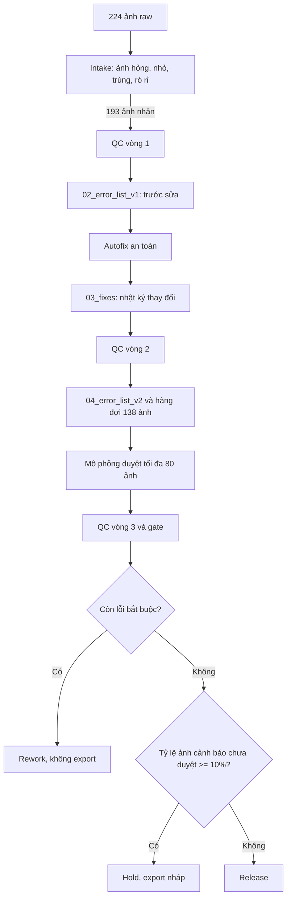

# Hướng dẫn hiểu bài lab và báo cáo Day 09

> Tài liệu học tập đi kèm, không thay thế [submission/REPORT.md](../submission/REPORT.md) và không phải sản phẩm bắt buộc để nộp. Nội dung dưới đây giải thích đúng lần chạy hiện tại của repo; nếu đổi cấu hình hoặc chạy lại pipeline, các con số có thể thay đổi.

## 1. Mục tiêu thật của repo

Bài lab đưa một lô ảnh đã có nhãn YOLO và yêu cầu xây một quy trình QC có thể tái lập. Máy xử lý các quy tắc có thể kiểm bằng dữ liệu: ảnh hỏng, kích thước thấp, trùng ảnh, thiếu file nhãn, ID lớp không hợp lệ, box sai hình học. Model checker chỉ nêu bất đồng có thể có. Người xem quyết định các vấn đề ngữ nghĩa như vật nào bị bỏ sót, nhãn lớp nào sai, hay box có ôm đúng vật không.

Kết quả cuối không được “làm cho đẹp”. **Release**, **Hold** hoặc **Rework** đều có thể là kết quả đúng nếu khớp bằng chứng. Repo cố ý đặt gate: lỗi bắt buộc còn lại thì Rework; không còn lỗi bắt buộc nhưng ít nhất 10% ảnh còn cảnh báo chưa duyệt thì Hold; chỉ còn lại mới Release.

## 2. Repo đã cho gì, bài yêu cầu gì, và đã làm gì

### Repo đã cho

- `data/raw/`: 224 ảnh và nhãn cần QC; lô raw **không có đáp án lỗi**.
- `data/calib/`: 39 ảnh có lỗi chèn đã biết; `MANIFEST.csv` được phép dùng cho calibration.
- `data/gold_val/`, `data/test/`: ảnh tham chiếu cho bước intake. Test chỉ dành cho đánh giá cuối, không được dùng để sửa nhãn hay chọn ngưỡng.
- `data/cache/`: dự đoán checker đã lưu sẵn, nên QC không cần GPU.
- Năm check mẫu: `missing_labels`, `class_names`, `images`, `stats`, `duplicates`.
- Orchestrator, hàng đợi và mô phỏng người duyệt, export, calibration, tests, báo cáo và notebook Colab.

### Bài yêu cầu người học

1. Hoàn thiện bốn stub: `pipeline/checks/label_format.py`, `pipeline/checks/second_opinion.py`, `pipeline/steps/autofix.py`, `pipeline/steps/gate.py`.
2. Chạy tests, calibrate đúng hai ngưỡng được đánh dấu trong `configs/pipeline.yaml`, rồi chạy `make run`.
3. Đọc các report do script tạo, tự nhìn ảnh để nhận ra những lỗi ngữ nghĩa mà máy có thể bỏ sót.
4. Viết `submission/REPORT.md`, đổi tiêu đề README, chạy `make check-core`.
5. Train raw vs clean trên Colab là phần tùy chọn, chấm riêng 15 điểm; hiện phần này được ghi trung thực là chưa chạy.

### Rubric để biết phần nào bắt buộc, phần nào tùy chọn

| Phần | Điểm | Trạng thái hiện tại |
|---|---:|---|
| 4 module đúng | 40 | Đã viết; 79 test đạt |
| Pipeline một lệnh và report đầy đủ | 15 | Đã chạy; Hold là kết quả hợp lệ |
| Calibration hai ngưỡng | 10 | Đã có sweep và ngưỡng được xác nhận |
| Phân tích lỗi, phân việc, kết luận và ghi chú AI | 15 | Đã điền `REPORT.md` |
| Train raw vs clean trên Colab | 15 | Tùy chọn, chưa làm; không train thì điểm tối đa là 85 |
| Tái lập và Git | 5 | Check-core đạt; 6 commit cá nhân mới đã push |

CVAT để lọc box nhỏ là tùy chọn thưởng tối đa +2. Không cần đạt Release để được điểm; cần báo đúng những gì số liệu chỉ ra.

### Những gì đã làm trong repo hiện tại

- Bốn module đã triển khai; `python -m pytest -q` đạt **79 passed**.
- Calibration chọn theo xác nhận của bạn: `duplicates.phash_dist=16`, `second_opinion.conf=0.25`.
- `make run` chạy 224 ảnh, nhận 193, tạo report, hàng đợi, mô phỏng duyệt 80 ảnh và kết luận **Hold**.
- `submission/export/clean_v1/` là export **nháp** có manifest ghi Hold; không được gọi là bản phát hành.
- Đã chạy thử gate với ngân sách 0: kết luận Rework, mã thoát 20, không có export.
- `make check-core` đạt 0 lỗi; cảnh báo duy nhất là phần train tùy chọn chưa chạy.
- Các file dữ liệu nguồn `data/raw/` không bị sửa. `work/` là nơi thử nghiệm và không phải nội dung cần nộp.

## 3. Luồng dữ liệu: từ raw đến kết luận



`submission/reports/02_error_list_v1.*` chứa cả issue cửa intake và QC vòng 1. `03_fixes.csv` chỉ ghi các sửa tự động ở thư mục làm việc; 31 ảnh intake bị loại được ghi ở `01_intake.*`, không nằm trong 35 fix đó. Sau sửa là `04_error_list_v2.*`; hàng đợi là `05_review_queue.csv`; log mô phỏng là `06_review_log.csv`; kết quả cuối là `07_error_list_v3.*` và `08_summary.json`.

Người duyệt của repo là mô phỏng: `scripts/human_review_sim.py` thay nhãn của tối đa 80 ảnh đầu hàng bằng nhãn tham chiếu. Đây không phải là 80 ảnh do bạn hoặc một người thật vừa kiểm. Việc bạn nhìn contact sheet và đưa ra các nhận xét cụ thể là phần quan sát người thật của bài.

## 4. Bốn module đã viết làm gì

### `label_format.run(ds, cfg)`

Đọc file nhãn tương ứng với từng ảnh, giữ số dòng gốc, rồi phân tích mỗi dòng YOLO thành `class_id, cx, cy, w, h`. Dòng sai số cột/số học thành `BAD_FORMAT`; ID ngoài danh sách lớp thành `BAD_CLASS_ID`; rộng/cao không dương thành `BOX_ZERO`. Ba lỗi này kết thúc kiểm tra hình học của dòng đó để tránh phát sinh lỗi dây chuyền.

Với dòng hợp lệ, tính bốn mép box: trái `cx-w/2`, phải `cx+w/2`, trên `cy-h/2`, dưới `cy+h/2`. Mức tràn là độ vượt lớn nhất khỏi [0,1]; chỉ báo `BOX_OUT_OF_IMAGE` nếu vượt `overflow_tol`. Box cùng lớp có IoU lớn hơn `dup_box_iou` so với một dòng trước đó sẽ bị báo `DUP_BOX`. Cạnh ngắn theo pixel nhỏ hơn `min_box_px` là `BOX_TINY`; diện tích tỷ lệ `w*h` lớn hơn `max_box_frac` là `BOX_HUGE`.

### `second_opinion.run(ds, cfg, preds=None)`

Dùng dự đoán checker đã cache nếu không truyền `preds`. Đây là **ý kiến thứ hai**, không phải đáp án chuẩn và không tự sửa nhãn. Dự đoán để tìm box thiếu cần confidence ít nhất `0.25` và diện tích ít nhất 600 pixel vuông. Với mỗi dự đoán, nhãn có IoU từ `iou_missing` trở lên là ứng viên cùng vật: không có ứng viên thì `POSSIBLE_MISSING`; có box cùng lớp nhưng IoU tốt nhất dưới `iou_loose` thì `POSSIBLE_LOOSE_BOX`; nếu chỉ khớp box khác lớp với IoU đủ cao thì `POSSIBLE_WRONG_CLASS`.

Chiều ngược lại, mỗi nhãn hợp lệ được so với mọi dự đoán confidence từ `fp_conf=0.1` trở lên. Nếu không dự đoán nào đạt `iou_missing`, tạo `POSSIBLE_FALSE_POS`. Các issue đều là WARN để người xem quyết định. Một ảnh có thể có nhiều issue; vì vậy tổng “issue” thường lớn hơn số ảnh.

### `autofix.fix(ds, issues, cfg)`

Chỉ xử lý issue ERROR, không động đến WARN. Dòng sai định dạng, class ID sai, box zero và box lặp được gom theo file rồi xoá theo **số dòng gốc**; nếu một dòng vừa cần xoá vừa cần clip thì xoá một lần. Box tràn được cắt về biên ảnh, nhưng box nằm hẳn ngoài ảnh bị xoá thay vì tạo box rỗng. Lỗi tên lớp sửa `data.yaml`. Ảnh bị loại được xoá khỏi bản sao làm việc cùng nhãn tương ứng.

`MISSING_LABEL_FILE` khác với file nhãn rỗng. Máy không biết vật nào có trong ảnh nên không tạo file rỗng (file rỗng có nghĩa “ảnh nền”); nó chỉ ghi action `needs_label` để chuyển người gán. Mỗi thay đổi có `before` và `after` để audit. Autofix chỉ sửa bản sao `work/run/ds`, không sửa `data/raw`.

### `gate.decide(issues, image_stems, cfg, reviewed)`

Đếm lỗi ERROR còn lại; chỉ cần một lỗi thì Rework, kể cả ảnh từng được duyệt. Với WARN, đếm **số ảnh khác nhau** trong dataset còn cảnh báo và chưa nằm trong `reviewed`, không đếm số issue. Công thức là `n_warn_images / n_images`; lần chạy này là `53/193 = 0.2746`, làm tròn bốn chữ số. Vì 27,46% lớn hơn ngưỡng 10%, verdict là Hold. Cảnh báo cấp dataset như `CLASS_RARE` không gắn với một stem ảnh nên không làm tăng tử số gate.

## 5. Đọc từng mục trong `submission/REPORT.md`

### Mục 1 — “Kết luận trước”

- **HOLD**: gate không cho phát hành vì còn quá nhiều ảnh có cảnh báo chưa được xử lý.
- **193/224 nhận**: mẫu số 224 là toàn bộ raw; intake loại 31. Phân rã 31: 2 ảnh hỏng + 3 ảnh nhỏ + 8 exact duplicate + 7 near duplicate + 11 ảnh trùng test/val.
- **Không còn lỗi bắt buộc**: sau mô phỏng duyệt, `n_errors=0` trong `08_summary.json`. Không đồng nghĩa nhãn đã hoàn hảo; WARN vẫn còn.
- **53/193 = 27,46%**: 53 ảnh khác nhau còn WARN chưa duyệt; ngưỡng cố định là 10%.
- **193 ảnh export nháp**: manifest tồn tại để thử nghiệm/trace; quyết định trong manifest vẫn là Hold.

### Mục 2 — “Lỗi và phân việc”

Câu đầu xác định nguồn số liệu. Intake được tính trên 224 ảnh đầu vào; check QC chạy trên 193 ảnh đã nhận. Trong bảng, các mã được ghép chung chỉ để gọn, nhưng từng số vẫn theo đúng thứ tự mã.

- `CORRUPT_IMAGE 2/224`: ảnh không đọc được. `BAD_SIZE 3/224`: cạnh ngắn dưới 250 px. Máy loại cả hai nhóm ở intake.
- `DUP_IMAGE_EXACT 8/224`: trùng từng byte; `DUP_IMAGE_NEAR 7/224`: gần giống theo perceptual hash; `LEAK_TEST 11/224`: khớp ảnh kho test/val. Máy giữ ảnh gặp đầu tiên và loại ảnh trùng/rò rỉ sau.
- `BAD_CLASS_ID 6`, `BAD_FORMAT 3`, `BOX_ZERO 4`, `DUP_BOX 7`: số issue/dòng lỗi ở QC của 193 ảnh; autofix xoá các dòng này.
- `BOX_OUT_OF_IMAGE 8`: tám dòng bị clip. `BAD_CLASS_NAME 2`: hai tên lớp viết hoa sai trong một `data.yaml`, được chuẩn hóa về car/person/truck/bus.
- `MISSING_LABEL_FILE 6/193`: thiếu hẳn file `.txt`, chuyển người gán. `EMPTY_LABEL 11` là có file nhưng không có dòng; máy không thể biết đây là ảnh nền đúng hay nhãn bị thiếu.
- `BOX_TINY 6`, `BOX_HUGE 3`, `CLASS_RARE 4`: issue WARN; không được autofix. `CLASS_RARE` là thống kê cấp dataset, không phải bốn ảnh.
- `POSSIBLE_MISSING 148 issue / 84 ảnh`: 148 dự đoán bị cờ trên 84 ảnh. `POSSIBLE_LOOSE_BOX 43/35 ảnh`, `POSSIBLE_WRONG_CLASS 20/19 ảnh`, `POSSIBLE_FALSE_POS 28/26 ảnh`. Đây là gợi ý của model, không phải xác nhận 148 vật thật sự bị bỏ sót.

`03_fixes.csv` có 35 bản ghi: 20 dòng bị xoá, 8 box bị clip, 6 ảnh thiếu nhãn được chuyển người, 1 lần chuẩn hóa lớp. Không có mâu thuẫn với 31 ảnh intake bị loại: intake loại trước khi tạo bản sao QC, còn CSV này là nhật ký autofix sau intake.

Hàng đợi 138 ảnh vượt ngân sách mô phỏng 80, nên 58 ảnh cuối hàng không được mô phỏng duyệt. `img_0160` đứng đầu với priority 35.692 và mã `POSSIBLE_MISSING;POSSIBLE_WRONG_CLASS`. Priority cộng trọng số theo loại cảnh báo, confidence và các fix liên quan; nhiều dự đoán trong một ảnh có thể làm điểm tăng. `06_review_log.csv` xác nhận 80 ảnh được mô phỏng thay nhãn bằng nhãn tham chiếu.

Các số v3 là **sau** bước đó: còn 90 POSSIBLE_MISSING issue trên 60 ảnh; 32 POSSIBLE_LOOSE_BOX trên 26 ảnh; 10 POSSIBLE_WRONG_CLASS trên 9 ảnh; 24 POSSIBLE_FALSE_POS trên 23 ảnh. Mẫu số ảnh giúp giải thích vì sao 90 cảnh báo missing không có nghĩa 90 ảnh.

### Mục 3 — “Calibration”

Calibration kiểm độ nhạy của chính check trên bộ 39 ảnh đã biết lỗi. `TP` là lỗi chèn được bắt đúng; `FP` là cờ nhầm; `FN` là lỗi bị bỏ sót. `precision = TP/(TP+FP)` trả lời “trong những gì bị cờ, bao nhiêu đúng?”; `recall = TP/(TP+FN)` trả lời “trong lỗi đã biết, bao nhiêu bắt được?”.

- `phash_dist=2 → 16`: near duplicate chuyển từ P/R `1.00/0.50` sang `1.00/0.83` — bắt 5/6 lỗi chèn, không có FP. Exact duplicate vẫn P/R `1.00/1.00` ở ngưỡng 16.
- Ở ngưỡng 20, bảng sweep cho exact P/R `1.00/0.33`: precision vẫn là 1.00; **recall** mới giảm còn 0.33. Nếu bản báo cáo trước đó ghi “precision exact giảm”, đó là nhầm tên chỉ số; đã sửa trong báo cáo hiện tại.
- `second_opinion.conf=0.25` vẫn bằng giá trị ban đầu, nhưng được giữ có chủ đích. P/R ở calib: wrong class `0.56/0.83`; missing `0.50/1.00`; loose box `0.29/0.40`; false positive `0.31/1.00`. Ví dụ missing có TP=8, FP=8, FN=0: bắt đủ 8 lỗi chèn nhưng một nửa cảnh báo missing là báo động giả trong bộ nhỏ này.
- Hạn chế: chỉ 39 ảnh, vài lỗi mỗi nhóm nên một TP/FN làm tỷ lệ đổi mạnh; calibration không có LEAK_TEST; checker và lỗi raw có thể khác phân bố. Do đó ngưỡng calib là căn cứ chọn, không phải bảo đảm hiệu suất ngoài raw.

### Mục 4 — “Cửa chặn và điểm mù”

Lệnh `--budget 0` bỏ qua mô phỏng duyệt. Sáu ảnh thiếu file nhãn vẫn còn lỗi bắt buộc vì autofix không thể bịa nhãn. Kết quả cần đọc đủ ba phần: verdict **Rework**, mã thoát từ lệnh Python là **20**, và `work/exp_nb/clean_v1` **không tồn tại**. `make run` thường bọc mã 0/10/20 thành mã make 0; khi cần kiểm mã gate phải gọi `python -m pipeline.run` trực tiếp.

Điểm mù là những gì check hiện tại không thể xác định chắc:

1. `img_0001`: theo quan sát của bạn, người chỉ thấy nửa thân bị thiếu box. Model đã có thể bỏ sót vật bị che khuất.
2. `img_0007`: theo quan sát của bạn, nhiều xe bị bỏ sót không đồng đều, nhất là các xe xa. Dự đoán model không thể thay thế rà soát toàn cảnh.
3. `img_0002`: bạn nghi hai box person rơi vào vật giống kiện hàng; model cũng có thể nhầm loại vật.
4. `img_0004`: file nhãn rỗng dù bạn thấy xe hơi. Train ngoài bốn lớp dự án nên không thể gán class train trong cấu hình hiện tại; xe hơi vẫn có thể là vật thiếu nhãn.

Đây là các nhận xét bằng mắt của bạn, không phải kết luận ground-truth được script xác minh. Câu trả lời tốt là giữ chữ “nghi/có thể” ở chỗ chưa được gán nhãn chuẩn.

Từ 53 ảnh cảnh báo hiện tại, để xuống dưới 10% trên 193 ảnh cần còn tối đa 19 ảnh cảnh báo (20/193 đã hơn 10%). Nghĩa là cần xử lý ít nhất 34 ảnh trong số 53 nếu các ảnh khác không phát sinh cảnh báo mới. Đây là điều kiện số học, không phải lý do để hạ ngưỡng hoặc đánh dấu ảnh đã xem khi chưa xem.

### Mục 5 — “Train”

“Chưa chạy” là kết quả trung thực: hiện chưa có `submission/results/` nên không có mAP, precision/recall của detector hay so sánh raw-clean. Không được suy ra clean tốt hơn chỉ vì QC đã loại lỗi. Phần Colab có thể làm sau; phải dùng cùng model, epoch, seed và tập đánh giá như hướng dẫn để so sánh công bằng.

### Mục 6 — “Quyết định và ghi chú AI”

Quyết định lặp lại Hold để kết thúc báo cáo nhất quán với `08_summary.json`. Ghi chú AI nên cho thấy có dùng AI, cách kiểm và một lỗi cụ thể đã sửa. Lỗi đã ghi là bản autofix ban đầu có thể log `needs_label` cho ảnh đồng thời bị loại; code hiện lọc bỏ log đó. Vì phần code được AI hỗ trợ, bạn cần đọc được các quy tắc và giải thích lý do chúng không tự gán nhãn ngữ nghĩa.

## 6. Lệnh và artefact để tự kiểm từng con số

```bash
python -m pytest -q
make calibrate
make run
make check-core
```

- Mở `submission/reports/01_intake.txt` để đối chiếu 31 ảnh bị loại.
- Mở `02_error_list_v1.csv` để đếm mã lỗi trước sửa; đếm distinct `image` khi câu hỏi là số ảnh, và số dòng CSV khi câu hỏi là số issue.
- Mở `03_fixes.csv` để thấy từng `before → after`.
- Mở `05_review_queue.csv` và `06_review_log.csv` để phân biệt ảnh được xếp hàng với ảnh thực sự được mô phỏng duyệt.
- Mở `07_error_list_v3.csv` và `08_summary.json` để xác nhận verdict cuối, số ảnh cảnh báo, số ảnh tổng và tỷ lệ.
- Mở `submission/calibration/calibration_report.md` để xem sweep; giá trị P/R luôn theo thứ tự precision rồi recall.

## 7. Còn gì để bạn tự làm/ghi nhớ

- Phần Colab là mở rộng tùy chọn, có thể làm sau. Nếu chưa chạy, câu “chưa chạy” trong report phải giữ nguyên.
- Trước lúc nộp, theo `SUBMISSION.md`, tên repo cần có dạng `K5-L23-DAY09-<MSHV>-AutoQCPipeline`; tên remote hiện tại khác mẫu này. Repo đã được push public, nhưng bạn cần tự đổi tên repo trong GitHub nếu lớp không cho ngoại lệ, rồi nộp link đúng lên LMS.
- `make check-core` hiện qua; `make check` đầy đủ sẽ đòi kết quả train và vì thế chưa phù hợp cho trạng thái hiện tại.

Nếu phải trình bày miệng, hãy tự trả lời được bốn câu: vì sao box tự sửa được nhưng class sai chỉ cảnh báo; vì sao 148 issue missing là 84 ảnh; vì sao 53/193 dẫn đến Hold; và vì sao kết quả calib 39 ảnh không chứng minh detector tốt hơn trên raw.
